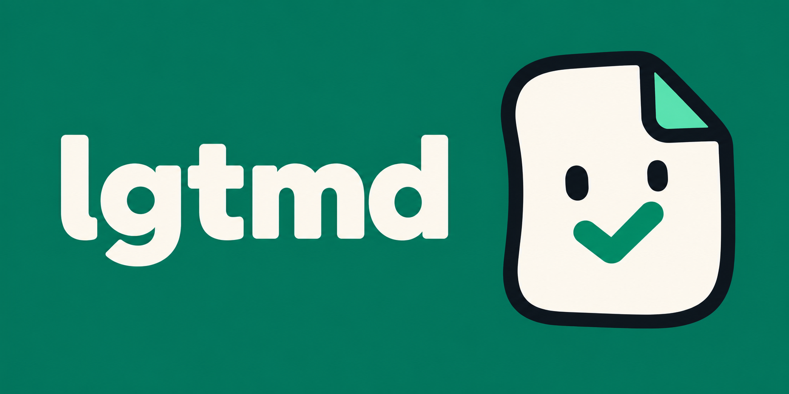

# lgtmd

**Your UI changes. Your docs' screenshots should too.**

Write the guide alongside the workflow it explains. Capture screenshots, values,
and downloads from that workflow in TypeScript or Rust, then include them directly
in your prose. Rerun it as the product changes, review the results, and check the
approved output in CI.

## Write the guide where the feature runs

This shortened [React + Vite example](examples/lgtmd-web/README.md) uses a
Playwright fixture that prepares sample records. Its runner builds the guide
after the tests and cleanup succeed.

```ts
import { withDocs } from "lgtmd/playwright";
import { test as appTest, expect } from "./application-test.ts";

const test = withDocs(appTest);

test("Find a record", async ({ page, workspace, doc }) => {
  doc.page({ id: "find-record", title: "Find a record" });
  await page.goto(workspace.url);
  await page.getByRole("searchbox", { name: "Search records" }).fill("Alpha");

  const results = page.getByRole("list", { name: "Records" });
  await expect(results.getByRole("listitem")).toHaveText([
    "Alpha contract",
    "Alpha renewal",
  ]);

  const image = doc.assets.image("matches", await results.screenshot());
  const instructions = doc.md`
    Enter **Alpha** in **Search records** to find matching records.

    ${image.embed("The two matching records")}
  `;
  doc.noteOn(instructions)`This guide uses three isolated sample records.`;
});
```

Readers get the instructions and screenshot. Your team also gets the attached
note, excluded from reader exports. Keep explanations, assertions, and captures
in one source, and review them in the same change as the feature.

## Fit it into your project

- **Keep your tooling.** Reuse Playwright actions, assertions, and fixtures. Write
  API, CLI, and library guides in ordinary TypeScript or Rust too.
- **Own your docs.** Export Markdown and resources to your documentation site or
  repository. Build a fresh candidate, review it, then accept the changes.
  Later checks fail when the accepted output changes.
- **Start with one guide.** In an existing app, choose a workflow whose docs keep
  going stale. In a new app, develop the feature, guide, and fixtures together.

Your project owns authentication, sample data, and cleanup. Assertions check the
behavior you specify; prose still needs review. Exact screenshot comparisons need
a controlled browser, fonts, platform, and data.

## Get started

**Experimental release: 0.3.0.** Install the Node SDK from npm's `latest` tag:

```sh
npm install --save-dev lgtmd
```

For Rust projects, add the SDK as a development dependency (Rust 1.95 or newer):

```sh
cargo add --dev lgtmd@0.3.0
```

The APIs and schema-v1 compiler input remain experimental.

- [Viewer showcase](examples/review/showcase/README.md) (source checkout) —
  run `just docs-demo` for retained text and full-page image comparisons, without Git history.
- [React + Vite walkthrough](examples/lgtmd-web/README.md) — client, HTTP API,
  Playwright setup, and the complete guide workflow.
- [Stay example](examples/stay/README.md) (source checkout) — detailed filters,
  guest/host requests, scripted AI replies, two fixture ownership patterns, and
  executable guides.
- [TypeScript SDK](packages/lgtmd/README.md) · [Rust SDK](crates/lgtmd/README.md) ·
  [Rust CLI and library examples](crates/doc-example-config/README.md).

The Node SDK runs as development tooling, outside your frontend bundle. Verified
setup: Node 24 ESM on macOS 15 arm64 and Ubuntu 24.04 x64. The initial Playwright
adapter requires a dedicated run with one project and no retries or sharding; see its
[configuration and limits](packages/lgtmd/README.md#playwright).

## A docs site built for review

Run `lgtmd dev` to read your guides and review text and screenshot changes against
recorded Git versions. Switch between Previous and Current, compare captures
side by side, or outline changed image regions. `lgtmd build` exports the same
reading experience as a static site.

The docs-site CLI and embedded frontend are included in the npm 0.3.0 package, with the Versions sheet and word/line text review.
See the [getting-started guide](docs/guide/getting-started.md),
[development workflow](docs/guide/develop-and-record.md), and
[real visual-review demonstration](docs/guide/review-changes.md).
Markdown exports remain available for your existing docs stack.

## Who is using

[**N3**](https://github.com/gridaco/n3) uses lgtmd for its executable user guides,
with application replay and screenshots from its own renderer.

[Contributing](CONTRIBUTING.md) · [MIT license](LICENSE)
