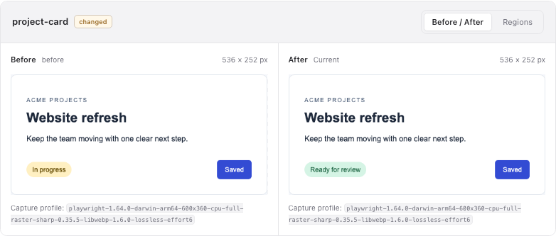
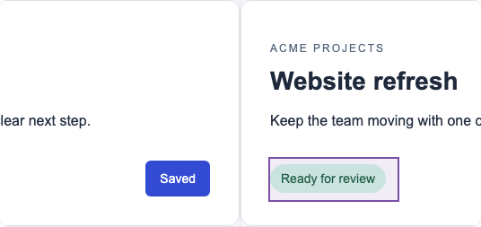

# Review text and image changes

Choose **View diff** to compare your current completed guide with its recorded version in Git. By default the baseline is the exact snapshot at **HEAD**. Select another revision to inspect an earlier result.

In development, open the **Versions** sheet to browse project commits by their message and date. History includes all commits reachable from local branches and tags, whether or not they changed documentation. Use **Older commits** and **Newer commits** to browse 20 at a time. Selecting a commit reads the documentation snapshot stored at that exact revision; a commit without one remains visible and explains why no comparison is available. Hover a date for its full timestamp. Use **Advanced** to enter a branch, tag or older commit, or to copy the current candidate ID. A candidate ID identifies completed generated documentation; it is not a Git revision. The Versions sheet is included in npm 0.3.0.

The change summary counts added, removed and modified **pages** and **assets**. These are documentation counts, not Git line counts. Selecting a version does not check out old code, run your app, or accept a baseline.

## Read both versions

Use **Previous** and **Current** to read the rendered guide. Changed-page navigation identifies additions, removals and changes. With **View diff** enabled, Current highlights additions in its own text and Previous highlights deletions in its own text. Headings and paragraphs show word changes; small corrections can show individual characters without splitting emoji or combining marks. Code blocks highlight changed lines. Switching highlights on or off keeps the selected version’s text and layout intact.

The demonstration also adds a paragraph above unchanged content, changes **draft** to **final**, corrects **descripton** to **description**, and updates one code line. Lists, tables, changed formatting and ambiguous replacements use whole-block markers. **Partial text diff** means some changes need whole-block or page-level review; open **Versions → Advanced** for the reason. Notes keep their existing comment presentation. Detailed text highlights are included in npm 0.3.0.

## Compare the screenshots

Open the small controls button in the image corner to choose **Slider** or **Side by side**. Slider overlays the aligned captures: drag the divider to reveal Before and After, or focus it and use the arrow keys, Home and End. Side by side preserves the frame height and each capture’s proportions in a horizontal strip. Scroll sideways to inspect either image without shrinking it into a narrow column. This real example changes the project status from **In progress** to **Ready for review** in both its explanation and screenshot.

Turn **Annotations** on independently to outline groups of changed pixels in either view. Turn it off to inspect the images without the marks. The boxes use compatible static PNG or WebP screenshots. Open **Details** for capture profiles, changed-pixel counts and any alignment limitations. Controls overlay the image so toggling review does not add header or footer rows to the document.

Boxes group changed pixels; they do not recognize semantic controls. Different dimensions or capture profiles, animations, unsupported formats and large images use the side-by-side view with an explanation when alignment or annotations are requested. Visual modes never change the exact artifact check result.

## Keep history honest

A revision with no recorded snapshot is reported as unavailable. The site does not recreate historical evidence by running old code. Missing resources and incompatible snapshots remain visible errors; current docs stay readable.

Start with **Reader** for user-facing content. An explicit Contributor session can show attached internal notes, and needs actual Contributor snapshots on both sides to review them.

## Try the demonstration

In a prepared lgtmd checkout, run **just docs-git-demo**. It starts this real comparison against a disposable, clearly labeled example history. Its sample notes are intentionally public. The example never creates commits in your project.

For an evergreen, Git-free tour of the same viewer, run **just docs-demo**. Its retained Original and Revised versions cover text, full-width page captures, a four-pixel image change, mismatched dimensions, notes, unchanged content and added or removed pages. Browsing does not rerun captures.

This page is itself authored with lgtmd. Its browser scenario asserts the real revision and changes, operates the comparison controls, then captures these images. The final guide is not an input to the example it explains.

